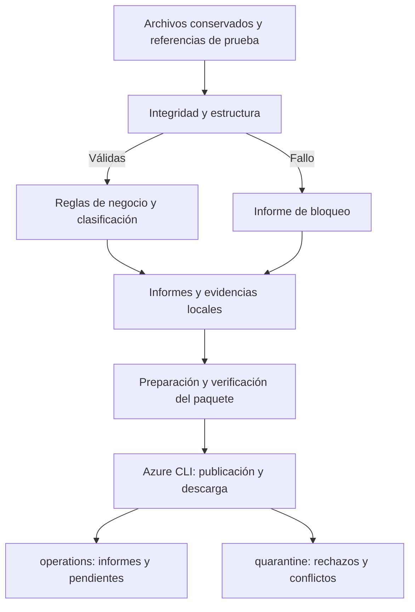

# M6 — Reglas de calidad, validaciones y cuarentena

## Resultado

Se implementaron validadores reutilizables de transporte, pedidos CSV,
eventos, extracciones de API y mapeo externo.

Los controles generan clasificaciones, informes y evidencias Parquet.
La suite completa superó 25 pruebas.

Se publicaron diez archivos en ADLS Gen2 y se verificaron mediante
descarga, tamaño y SHA-256.

## Alcance

El catálogo contiene DQ001–DQ017.
Los controles se aplican según la fuente y el alcance del evaluador;
no todos los evaluadores ejecutan todas las reglas.

Las entradas incluyen archivos conservados de M5, el conjunto inicial
verificado y escenarios sintéticos de M2.

Los eventos se comparan contra referencias fijas de prueba.
No se actualiza un estado persistente ni se aplican eventos en Silver.

Las tablas Delta corresponden a M7.
La aplicación incremental, marcas de agua e idempotencia persistente
corresponden a M8.

## Servicios y herramientas

| Componente | Uso en M6 |
|---|---|
| ADLS Gen2: starlpdevdiego01 | Conservar informes y evidencias |
| operations | Informes y eventos pendientes |
| quarantine | Rechazos y conflictos |
| Microsoft Entra ID | Autenticación de Azure CLI |
| Python | Evaluación, informes, hashes y preparación |
| PyArrow | Escritura y lectura de Parquet |
| unittest | Pruebas automatizadas |
| Azure CLI | Publicación y descarga de verificación |
| Git y GitHub | Versionado e integración |

La validación se ejecutó en WSL con el entorno virtual del proyecto.
La publicación utilizó la identidad de la sesión de Azure CLI.

ADF, SHIR y Key Vault forman parte de la ingesta previa.
Los validadores de M6 todavía no están orquestados por ADF.
No se desplegó Databricks para este módulo.

## Flujo implementado

Los archivos de entrada se conservan.
Los registros aceptados se contabilizan; estos comandos no publican
tablas Silver ni generan un nuevo estado comercial.

## Clasificación

| Resultado | Tratamiento |
|---|---|
| accepted | Supera los controles evaluables del alcance |
| rejected | Conserva motivos y evidencia de rechazo |
| conflict | Conserva contradicción y referencia comparada |
| pending | Conserva dependencia o secuencia pendiente por separado |
| duplicate | Identifica una repetición equivalente |
| blocked | Impide avanzar con una entrada incompatible |

completed_for_scope indica evaluación terminada, aunque haya rechazos.
No representa aceptación completa del lote ni publicación en Silver.

Una línea inválida impide aceptar su pedido completo.
Los pedidos independientes pueden seguir aceptados.

## Flujo implementado

Los archivos de entrada se conservan.
Los registros aceptados se contabilizan; estos comandos no publican
tablas Silver ni generan un nuevo estado comercial.

## Clasificación

| Resultado | Tratamiento |
|---|---|
| accepted | Supera los controles evaluables del alcance |
| rejected | Conserva motivos y evidencia de rechazo |
| conflict | Conserva contradicción y referencia comparada |
| pending | Conserva dependencia o secuencia pendiente por separado |
| duplicate | Identifica una repetición equivalente |
| blocked | Impide avanzar con una entrada incompatible |

completed_for_scope indica evaluación terminada, aunque haya rechazos.
No representa aceptación completa del lote ni publicación en Silver.

Una línea inválida impide aceptar su pedido completo.
Los pedidos independientes pueden seguir aceptados.

## Resultados verificados

| Control | Resultado |
|---|---|
| Suite completa | 25 pruebas superadas |
| DummyJSON de M5 | 38 productos aceptados |
| BCRPData de M5 | 195 observaciones aceptadas |
| Disponibilidad BCRPData | 184 tasas disponibles y 11 no disponibles |
| Mapeo externo | Seis asociaciones válidas |
| S13 y S14 | Conflictos de identidad o secuencia |
| S15 | Transición de estado inválida rechazada |
| S16 | Producto inexistente y exclusión del pedido afectado |
| S17 | Descuento inválido y exclusión del pedido afectado |
| S18 | Bloqueo por hash incorrecto |
| S19 | Un pedido en conflicto y cuatro líneas rechazadas |
| S20 | Modificación de atributo estable rechazada |
| batch_002 contra referencia posterior | Un duplicado y un pendiente |

También se comprobaron defectos de manifiesto, archivos ausentes,
conteos incorrectos, encabezados incompatibles, paginación,
fechas, tasas y asociaciones repetidas.

Los valores no disponibles de BCRPData se conservan sin convertirlos
en cero. Los importes se interpretan mediante Decimal.

## Evidencias publicadas

| Contenedor | Archivos |
|---|---:|
| quarantine | Tres Parquet |
| operations | Seis informes y un Parquet de pendientes |
| Total | Diez |

Rutas:

    operations/quality/run_id=<processing_run_id>/report.json
    quarantine/source=<source_system>/entity=<entity>/run_id=<processing_run_id>/
    operations/pending_events/run_id=<processing_run_id>/

Publicación UTC:

- Inicio: 2026-10-13T02:22:31.206992+00:00.
- Fin: 2026-10-13T02:23:11.475247+00:00.

Corresponde al 2026-10-12 en America/Lima.

Todos los objetos publicados se descargaron y coincidieron en tamaño
y SHA-256 con el paquete preparado.
El informe local terminó completed con diez entradas verified.
Se comprobó su correspondencia con el hash del plan de publicación.

Los tres Parquet de cuarentena conservan evidencias de S19 y S13.
El Parquet de pendientes corresponde a batch_002.

Estas evidencias sintéticas provienen de evaluaciones locales.
Sus ingestion_run_id permanecen nulos; processing_run_id identifica
la evaluación. No se atribuyen a una ingesta cloud inexistente.

## Controles de publicación

- Paquete completo verificado antes de llamar a Azure CLI.
- Destinos limitados a operations y quarantine.
- Parquet publicados antes de los informes.
- Sobrescrituras impedidas.
- Descarga y comparación de cada objeto.
- Registro local de avances y fallos.
- Paquete e informes operativos excluidos de Git.

La publicación de varios objetos no es una transacción atómica.
Un fallo conserva los objetos publicados y requiere revisión.
No se implementó reanudación automática.

El preparador exige una fuente y entidad por Parquet.
Los archivos con entidades mezcladas requieren separación previa.

## Aprendizajes y puntos clave

- Un hash correcto demuestra integridad, no validez comercial.
- Un lote bloqueado se distingue de registros rechazados.
- Un evento pendiente no equivale a un rechazo.
- Los conflictos necesitan una referencia explícita.
- La validez de una cabecera depende de sus líneas.
- Los conteos deben reconciliar categorías mutuamente excluyentes.
- Una asociación educativa no demuestra equivalencia comercial.
- La evidencia conserva motivos y procedencia para investigar.
- Publicar un archivo requiere verificar el contenido almacenado.

## Costos y revisión operativa

M6 generó operaciones de escritura y lectura en Storage.
Las evidencias conservadas generan consumo de capacidad.

No se ejecutaron pipelines de ADF para estas validaciones
ni se desplegó cómputo Databricks.

Revisión realizada en Azure Portal el 2026-10-12, America/Lima.
Cost Management estaba en el alcance rg-arlp-dev, Azure for Students,
para octubre de 2026.

| Servicio | Costo mostrado USD |
|---|---:|
| Azure Data Factory v2 | 0.02 |
| Storage | < 0.01 |
| Key Vault | < 0.01 |
| Bandwidth | 0.00 |
| Total mostrado del grupo | 0.02 |

Los valores mostrados están redondeados y son provisionales.
El total incluye los servicios compartidos de los módulos anteriores.
No representa el costo exclusivo de M6 ni el crédito restante.
La reconciliación definitiva por módulo permanece pendiente.

En adf-arlp-dev-diego01 se comprobó:

- Sin triggers configurados.
- Sin sesiones activas de Data Flow Debug.

Se conservan las entradas y evidencias verificadas para continuar M7.
No se modificó la configuración de los servicios en esta revisión.

## Conclusiones

M6 establece controles comprobados antes del procesamiento posterior
y un mecanismo de conservación de evidencias de calidad.

Los resultados permiten continuar con Silver manteniendo explícitos
los rechazos, conflictos, pendientes y controles no evaluados.

La ejecución integrada con estado persistente deberá comprobarse
en los módulos siguientes; las referencias de prueba no la sustituyen.

## Estado

Implementación y publicación de evidencias verificadas.
Cierre técnico documentado y revisión operativa realizada.
M6 completado para el alcance de reglas, validaciones y cuarentena.
Integrado en main mediante el pull request #11.
Commit de integración: 0b745bc.
Las limitaciones y pendientes descritos conservan su alcance.
